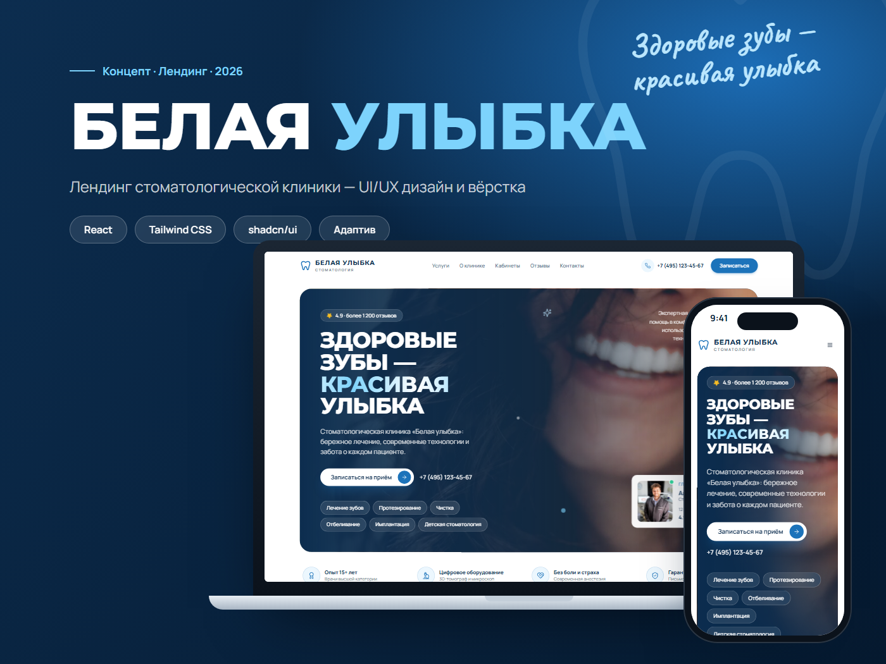
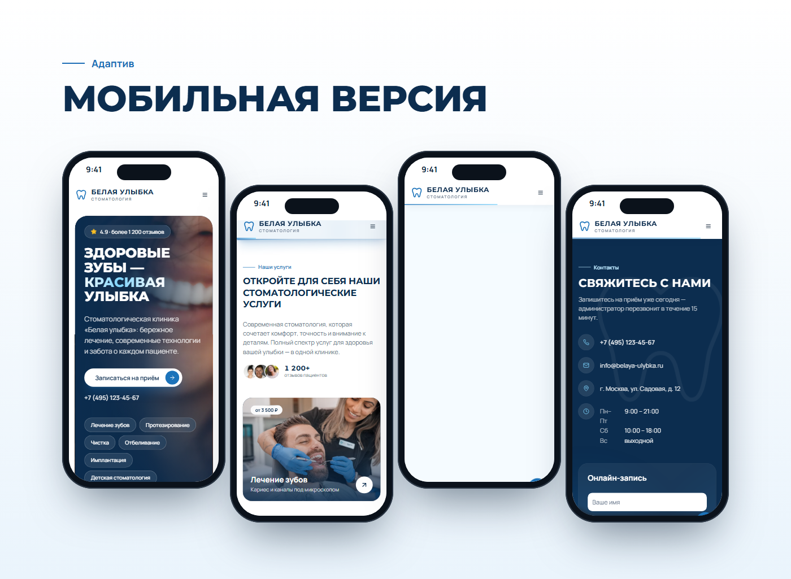

# Белая улыбка — лендинг стоматологической клиники

Концепт-проект: светлый современный лендинг для стоматологии с записью на приём, анимациями и адаптивной вёрсткой.



## Что внутри

- **Первый экран** — оффер, кнопка записи, услуги и карточка врача
- **Услуги** — 6 карточек с фото и ценами
- **О клинике** — врачи и «набегающие» цифры доверия
- **Кабинеты**, **отзывы**, баннер-призыв
- **Онлайн-запись** — проверка полей, маска телефона, анимированный успех
- **Анимации** — появление при прокрутке, реакция на наведение, бегущая строка; учитывается системная настройка «уменьшить движение»
- **Адаптив** — от 375 px до широких экранов



## Стек

React 18 · TypeScript · Vite · Tailwind CSS · shadcn/ui (Radix UI) · lucide-react

## Запуск

```bash
npm install
npm run dev
```

Сайт откроется на http://localhost:5173. Сборка для публикации — `npm run build` (папка `dist`).

При каждом push в `main` сайт автоматически публикуется на GitHub Pages (`.github/workflows/deploy.yml`).

## Структура

```
src/
  App.tsx            — все секции лендинга и данные (услуги, врачи, отзывы, контакты)
  lib/motion.tsx     — появление при прокрутке, счётчики, отслеживание прокрутки
  components/ui/     — компоненты shadcn/ui
portfolio/
  behance.html       — модули кейса для Behance
  posts.html         — карусель и сторис для Instagram / Telegram
  export.mjs         — экспорт модулей и постов в PNG
  export/            — готовые картинки
```

## Примечания

Клиника, врачи, отзывы и контакты вымышлены — это концепт для портфолио. Фотографии — [Unsplash](https://unsplash.com).

---

Дизайн и вёрстка — [@daniosy](https://t.me/daniosy)
